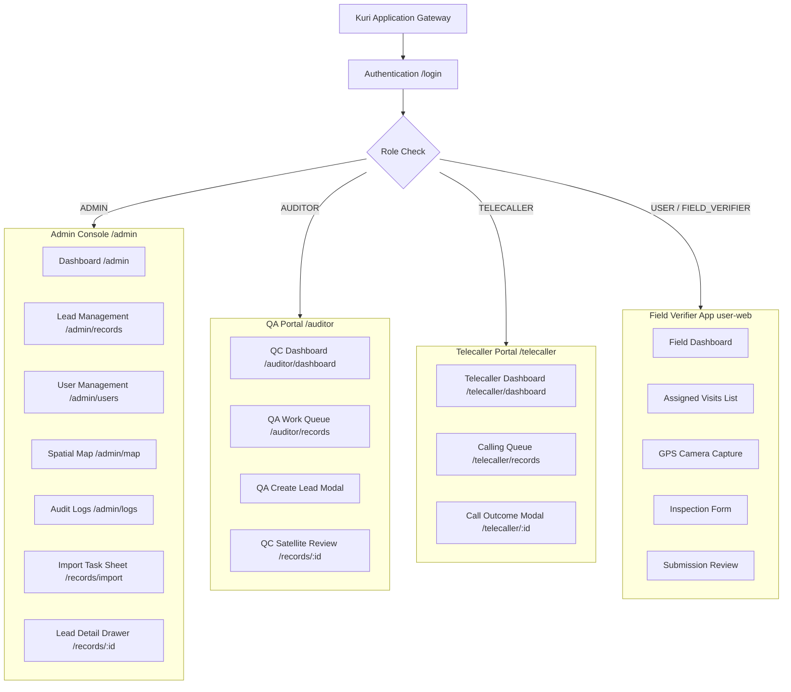
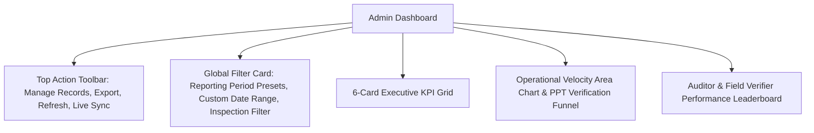
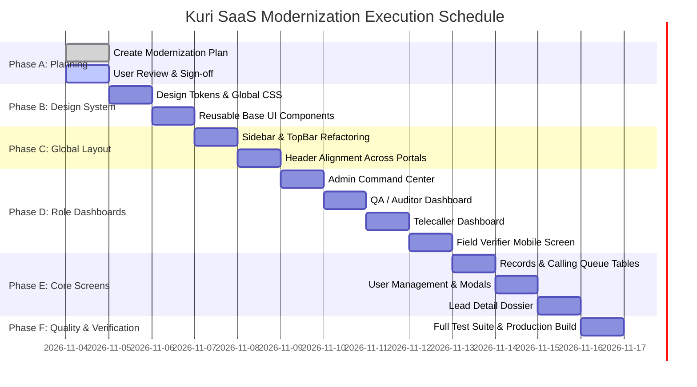

# Kuri Lead Management System — Complete Modern SaaS UI/UX Modernization Plan

> **Document Version:** 1.0.0  
> **Target Platforms:** Admin Portal, Telecaller Portal, QA / Auditor Portal, Field Verifier Mobile App  
> **Status:** Pending User Approval (Phase A Deliverable)  
> **Design References:** 
> - Reference 1: Figma Analytics Dashboard (`https://www.figma.com/design/h6awXI03jK00ELSvpJRGjA/Analytics-Dashboard--Community-?node-id=2-3214`)
> - Reference 2: Local Dasher UI Template (`C:\Users\Samuel P\Downloads\dasher-ui-v1.0.0` — Read-Only Reference)
> - Reference 3: Orbit Admin Dashboard (`https://preview.themewagon.com/orbit/#/dashboard`)
> - Reference 4: Uploaded Production Reference (`hr-dashboard-kit-code.vercel.app` layout)

---

## 1. Executive Summary & Architectural Vision

The **Kuri Lead Management System** is an enterprise-grade platform coordinating construction lead discovery, field inspections, satellite VHR quality audits, and contractor telecalling across Tamil Nadu (Coimbatore & Chennai).

While the application features robust backend services (FastAPI, SQLite/PostgreSQL, Google Maps, OpenRouteService, automated notifications, 5-revision audit history), the front-end user experience currently suffers from accumulated visual debt:
- **Disparate button sizing & styling:** Inconsistent heights (24px, 28px, 30px, 34px, 38px), hardcoded inline styles, and conflicting CSS rules in `theme.css`.
- **Inconsistent layouts across portals:** Admin, QA, Telecaller, and Field Verifiers lack a shared design vocabulary.
- **Visual clutter in high-density tables:** Dense tabular data without clear visual hierarchy, varying typography, and non-standardized column filter controls.
- **Outdated dashboard presentation:** Under-utilized screen real estate, inconsistent metric card paddings, and absence of standardized data visualization components.

### Modernization Objective
Transform the entire application into a **commercial-grade, high-density, accessible B2B SaaS platform** with:
1. A unified **Design System** (Design tokens, Tailwind utility integration, unified typography, consistent border radii, and accessible semantic colors).
2. Four **Distinct Role-Specific Dashboards** displaying strictly accurate, role-authorized metrics and interactive operational funnels.
3. Completely **Standardized Tables, Modals, Forms, and Navigation Bars** across all screens.
4. **Zero Backend Disruption**: Full preservation of all database schemas, API contracts, RBAC isolation, and business logic.

---

## 2. Current Architecture & Codebase Inventory

### 2.1 Technology Stack

| Layer | Technologies & Libraries | Current Status / Notes |
| :--- | :--- | :--- |
| **Admin Frontend** | React 19.2.8, TypeScript 6.0, Vite 8.2, React Router 7.18, Axios, Leaflet 1.9, Tailwind CSS 3.4 | Modern React/Vite stack; heavy monolithic `theme.css` (6,350 lines) requires systematic tokenization. |
| **Field Verifier App** | React 19.0.0, TypeScript 5.7, Vite 6.0, `vite-plugin-pwa` (PWA) | Mobile-first touch interface; geolocation hooks, offline sync capabilities. |
| **Backend API** | FastAPI (Python 3.12), SQLAlchemy 2.0, Pydantic v2, Alembic, SQLite/PostgreSQL | Fully asynchronous, modular routers (`admin`, `telecaller`, `quality`, `records`, `notifications`, `location`, `auth`). |
| **Authentication & RBAC** | JWT Bearer Tokens (`ADMIN`, `TELECALLER`, `AUDITOR`, `USER`/`FIELD_VERIFIER`) | Role isolation strictly enforced in DB queries and notification streams. |

### 2.2 Inventory of Screens & Portal Routes



### 2.3 Existing UI Debt & Component Friction

1. **Top Header & Action Buttons:**
   - Button heights vary between 28px (`App.tsx`), 30px (`Records.tsx`), 34px (`TelecallerDashboard.tsx`), and 36px (`Dashboard.tsx`).
   - Inline styles frequently override class rules (e.g. `style={{ display: 'inline-flex', padding: '4px 9px' }}`).
2. **Card Dimensions & Visual Inconsistencies:**
   - Some metric cards have `border-radius: 12px`, others `14px` or `16px`.
   - Hover states lack unified elevation physics.
3. **Table Headers & Filter Bars:**
   - Filter dropdowns have differing border colors (`#cbd5e1`, `#e2e8f0`, `#f1f5f9`).
   - Sticky table headers occasionally overlap with column filter popovers.
4. **Modal Window Architectures:**
   - Different modals (`QaCreateRecordModal`, `TelecallerRecordModal`, `BulkEditModal`, `LeadInfoModal`) use separate overlay and close button implementations.
5. **Mobile Navigation Overlaps:**
   - Field Verifier mobile navigation floating pills occasionally collide with bottom action safe areas.

---

## 3. Global Design System Specification

### 3.1 Design Principles
- **Data Density without Slop:** Crisp typography, compact borders, and meaningful negative space that prioritizes actionable lead data.
- **Card Hierarchy:** Highlighting active counts with soft pastel icon squircles, top-right trend/status pills, bold numbers, and distinct subtext.
- **Consistent Elevation Physics:** Subtle 1px borders (`#e2e8f0`) with soft drop-shadows on hover (`translateY(-2px)` to `translateY(-3px)`).
- **Universal Accessibility:** WCAG 2.1 AA compliant contrast ratios for all text, badges, and focus rings.

### 3.2 Color Tokens & Semantic Statuses

| Token Name | Hex Code | Usage Scenario |
| :--- | :--- | :--- |
| `--surface-canvas` | `#f8fafc` (Slate 50) | Global page background |
| `--surface-card` | `#ffffff` (White) | Card containers, modal sheets, tables |
| `--surface-muted` | `#f1f5f9` (Slate 100) | Filter bar backgrounds, hover tracks |
| `--border-subtle` | `#e2e8f0` (Slate 200) | Default card and divider borders |
| `--border-hover` | `#cbd5e1` (Slate 300) | Interactive card hover border |
| `--text-primary` | `#0f172a` (Slate 900) | Primary headlines, metric values, table text |
| `--text-secondary` | `#475569` (Slate 600) | Card labels, table column headers |
| `--text-muted` | `#64748b` (Slate 500) | Subtitles, helper text, timestamps |
| **Brand Primary** | `#2563eb` (Blue 600) | Primary SaaS CTAs, active pills, brand accent |
| **Status: Completed / Approved** | `#059669` (Emerald 600) | Verified visits, QC approvals, confirmed calls |
| **Status: Pending / Action** | `#d97706` (Amber 600) | Pending inspections, awaiting QA, callbacks |
| **Status: Rejected / Unreachable**| `#e11d48` (Rose 600) | Disapprovals, invalid sites, wrong numbers |
| **Status: Commercial / Corporate**| `#7c3aed` (Violet 600) | Big Builder commercial sites, QC desk exclusive |
| **Status: Ground Scope / Leads** | `#0284c7` (Sky 600) | Eligible ground visits, newly created leads |

### 3.3 Standardized Typography Scale

```
Display 1 (Dashboard Page Titles)  : 1.45rem (23px) | 800 Weight | -0.025em tracking | #0f172a
KPI Metric Numbers                 : 1.85rem (30px) | 800 Weight | -0.030em tracking | #0f172a
Section Headings                   : 1.05rem (17px) | 700 Weight | -0.015em tracking | #0f172a
Card Titles / Table Headers        : 0.82rem (13px) | 700 Weight |  0.010em tracking | #1e293b
Body Text / Table Cells            : 0.81rem (13px) | 500 Weight |  0.000em tracking | #334155
Micro Badges / Subtext             : 0.72rem (11px) | 600 Weight |  0.020em tracking | #64748b
```

### 3.4 Button & Control Standards

| Button Variant | Height | Padding | Border Radius | Font Size / Weight | Visual Appearance |
| :--- | :--- | :--- | :--- | :--- | :--- |
| **Primary CTA** | `36px` | `0 14px` | `9px` | `12px` / 600 | Solid blue/purple/red, white text, subtle shadow |
| **Secondary Outline**| `36px` | `0 13px` | `9px` | `12px` / 600 | White bg, 1px `#e2e8f0` border, `#334155` text |
| **Small Table Action**| `30px` | `0 10px` | `7px` | `11px` / 600 | Compact row action (Details, Call, Edit) |
| **Icon Button** | `36px` × `36px`| `0` | `9px` | `16px` icon | Centered icon, outline or soft tint |
| **Status Pill** | `24px` | `0 8px` | `9999px` | `11px` / 700 | Tinted bg (`#ecfdf5`), border, matching colored text |

---

## 4. Application Layout & Navigation Redesign

### 4.1 Global Sidebar Navigation (`Sidebar.tsx`)
- **Branding Section:** Clean logo container (`height: 36px`), application eyebrow tag ("Construction Lead Intelligence"), and smooth toggle arrow (`chevron_left` / `chevron_right`).
- **Collapsible Architecture:** 
  - Expanded: `width: 250px`, showing icon, label, and role pill.
  - Collapsed: `width: 72px`, icon-only with tooltip flyout.
- **Role-Based Filtering:** Automatically filters items based on `user.role` (`ADMIN`, `AUDITOR`, `TELECALLER`, `MANAGER`).
- **Active State Indicator:** Left indicator border (`3px solid #2563eb`), soft background pill (`#eff6ff`), and active text contrast.

### 4.2 Standardized Top Navigation Bar (`TopBar.tsx`)
- **Breadcrumb Navigation:** `Portal > Page > Sub-section` (e.g. `Admin Console > Records > CBE-10492`).
- **Global Search:** Multi-ID instant search bar with shortcut key (`/` or `Ctrl+K`).
- **Real-Time Notification Bell:** Badge counter, chime mute toggle, browser push notification permission handler, and role-filtered alert popover.
- **User Avatar & Profile Pill:** Initials avatar squircle, user full name, role badge, quick change-password modal, and sign-out button.
- **Synchronized Header Action Slot:** Consistent height (`36px` or `32px` sm) for all page-level primary actions.

---

## 5. Role-Based Dashboard Specifications

### 5.1 Admin Dashboard (`/admin`)
*Target User: Super Admin, Operations Director, General Manager*



#### Metrics & KPI Cards:
1. **Total Properties Catalogued:** `totalRecords` | Subtext: `eligibleForField` eligible • `qaNewRecords` QANEW.
2. **Ground Verification Scope:** `eligibleForField` | Subtext: `% Verified` rate, completed vs pending.
3. **Completed Inspections:** `completedVerifications` | Subtext: `manuallyAdded` on-site additions.
4. **Constructions Confirmed:** `confirmedConstruction` | Subtext: `% Hit Rate` of active building work.
5. **Commercial & Big Builders:** `commercialCount` (50) | Subtext: QC Desk Exclusive corporate projects.
6. **Phone Numbers Collected:** `phonesObtained` | Subtext: Direct owner & contractor contact yield.

#### Analytics & Leaderboard:
- **Trend Curve:** Daily completion volume vs dispatched tasks.
- **Funnel Breakdown:** 8-stage operational split (Identified -> Excluded -> Eligible -> Visited -> Confirmed -> Phone Captured).
- **Inspector Leaderboard:** Ranking field agents by completion speed and hit rate.
- **QA Auditor Matrix:** Tracking approvals, disapprovals, and newly mapped sites per auditor.

---

### 5.2 Telecaller Dashboard (`/telecaller/dashboard`)
*Target User: Telecalling Agent, Call Center Manager*

#### Metrics & KPI Cards:
1. **Total Leads with Phone:** `metrics.total_eligible` | Badge: `Eligible Leads`.
2. **Pending Calls:** `metrics.pending_calls` | Badge: `To Call` (Amber).
3. **Construction Confirmed:** `metrics.construction_confirmed` | Badge: `Verified` (Emerald).
4. **Follow Up Needed:** `metrics.connected_follow_up` | Badge: `Callbacks` (Blue).
5. **Not Reachable:** `metrics.not_reachable` | Badge: `Retry` (Rose).
6. **Calls Today:** `metrics.called_today` | Badge: `Daily Velocity` (Purple).

#### Key Operational Views:
- **Quick Action Bar:** Direct link to calling queue with count badge.
- **Calling Conversion Funnel:** Progress bar breakdown of contacted vs confirmed vs unreachable leads.
- **Recently Logged Calls Table:** Clickable table rows that open `TelecallerRecordModal`, displaying owner name, verified phone number, call status chip, expandable remark, and timestamp.

---

### 5.3 QA / Auditor Dashboard (`/auditor/dashboard`)
*Target User: GIS Auditor, Satellite QC Specialist*

#### Metrics & KPI Cards:
1. **Total Queue:** `data.total` | Badge: `Total Queue` (Blue).
2. **QC Done & Approved:** `data.done` | Badge: `% Done` (Emerald).
3. **Pending Review:** `data.pending` | Badge: `Action Required` (Amber).
4. **Commercial & Corporate:** `50` | Badge: `QC Exclusive` (Violet).

#### Quality Review Components:
- **QC Review Completion Velocity Bar:** Dual-progress bar with percentage, target line, and unit counts.
- **VHR Satellite Findings Breakdown:** Searchable card list of findings (e.g., Foundations visible, Framing active, Vacant land) with percentage share and direct navigation into filtered queue.
- **Direct QA Queue Launch Banner:** 1-click jump into next pending inspection.

---

### 5.4 Field Verifier Dashboard (`user-web`)
*Target User: Field Verification Agent on Mobile Phone*

#### Metrics & KPI Cards:
1. **Assigned Records:** `stats.total_records` | Coral squircle, `ALL QUEUE` badge.
2. **Completed Visits:** `stats.total_completed_records` | Emerald squircle, `COMPLETED` badge.
3. **Construction: Yes:** `stats.construction_yes_records` | Amber squircle, `ACTIVE SITES` badge.
4. **Mobile Numbers:** `stats.mobile_numbers_collected` | Purple squircle, `CONTACTS` badge.
5. **Field Added Sites:** `stats.manually_added_records` | Blue squircle, `NEW LEADS` badge.

#### Mobile Field UX:
- **Live GNSS Telemetry Bar:** Real-time satellite fix indicator, horizontal accuracy in meters, and retry button.
- **Touch-Friendly Filter Bar:** Segmented pill tabs (`All time`, `Today`, `Yesterday`, `This week`).
- **Cluster Proximity Mode Toggle:** Expandable/collapsible drawer for 50m, 100m, and Village clusters.
- **Daily Inspection Volume Chart:** Compact activity sparkline.

---

## 6. Complete Internal Page Modernization

### 6.1 Lead Management (`Records.tsx` & `TelecallerRecords.tsx`)
- **Table Density & Styling:** 
  - Standardized row height (`44px`), soft hover row highlight (`#f8fafc`).
  - Monospace font for Unique IDs (`#0f172a`, font-weight 700).
  - Expandable cell text for long remarks and owner names.
- **Column Header Filtering:** 
  - Unified filter popover with live search, selection counter badge, and clear button.
- **Bulk Action Bar:** 
  - Floating bottom bar appearing when rows are checked (Assign Verifier, Assign Auditor, Bulk Edit, Export Selected).

### 6.2 User Management (`Users.tsx`)
- **Modern User Cards & Table:**
  - Deterministic soft-tint avatar squircle with user initials.
  - Role pill badges (`ADMIN`, `TELECALLER`, `AUDITOR`, `FIELD_VERIFIER`).
  - Active/Inactive toggle switch.
- **Add / Edit User Modal:**
  - Modern two-column form layout, role picker, and secure temporary password generator.

### 6.3 Lead Detail & Inspection Review (`RecordDetail.tsx`)
- **Two-Column Responsive Dossier:**
  - Left column: Property overview, cadastral survey data, Google Geocoded address comparison, and 5-revision modification history ledger.
  - Right column: High-resolution inspection photo gallery with GPS watermark overlay, Street View side-by-side, and QA review decision panel.

---

## 7. Reusable Component Library Architecture

To prevent code duplication, the following unified components will be organized under `admin/src/components/common/` and `user-web/src/components/common/`:

```
admin/src/components/common/
├── StatCard.tsx              # Modern KPI card with pastel squircle, trend pill, and subtext
├── PageHeader.tsx            # Standardized page title, description, and action button bar
├── DataTable.tsx             # Standardized SaaS table container with sticky headers and pagination
├── FilterPillGroup.tsx       # Segmented pill radio buttons for timeframes and status
├── StatusBadge.tsx           # Semantic status badge (Approved, Pending, Disapproved, etc.)
├── ModalShell.tsx            # Accessible modal container with backdrop, header, and action footer
├── FormField.tsx             # Standardized form input, label, helper text, and validation error
└── AvatarSquircle.tsx        # Deterministic pastel avatar with initials
```

---

## 8. Implementation Phases & Roadmap



### Phase Details:
- **Phase A (Current):** Analysis, inventory, reference audit, and `UI_MODERNIZATION_PLAN.md` creation.
- **Phase B (Design System):** Clean token setup in `admin/src/index.css` & `admin/src/theme.css`. Implementation of reusable primitives (`StatCard`, `PageHeader`, `StatusBadge`, `ModalShell`).
- **Phase C (Global Layout):** Modernized sidebar (collapsible, tooltips, brand header) and unified TopBar across all roles.
- **Phase D (Role Dashboards):** Full deployment of modernized KPI cards, charts, and funnels for Admin, QA, Telecaller, and Field Verifiers.
- **Phase E (Internal Screens):** Overhaul of Records table, Telecaller calling queue, Users screen, and Lead detail modals.
- **Phase F (Testing & Verification):** Production Vite builds (`admin` and `user-web`), end-to-end responsiveness check (360px mobile to 1920px desktop), and backend regression testing.

---

## 9. Backend Safety, Data Accuracy & Risk Mitigation

| Risk Area | Potential Failure Mode | Architectural Mitigation Rule |
| :--- | :--- | :--- |
| **Database Schema** | Accidental migration or column rename | **Zero DB Changes:** Strictly read/write existing columns via existing ORM models. |
| **API Contracts** | Broken request/response schemas | **Zero API Changes:** Reuse existing endpoints (`/admin/dashboard`, `/telecaller/dashboard`, `/admin/records`, etc.). |
| **Role Permissions** | Cross-role data leakage | Enforce existing RBAC filters (`canAdmin`, `auditOnly`, `user.role`) at component render and API level. |
| **Fabricated Metrics** | Showing dummy percentage or unverified stats | All KPI values are wired strictly to live backend calculations (`totalRecords`, `completedVerifications`, etc.). |
| **Build Regressions** | TypeScript type errors or Vite bundle bloat | Execute `tsc -b && vite build` and Pytest suite after every phase before proceeding. |

---

## 10. Next Immediate Step

Awaiting your explicit review and approval of this plan. Upon your approval, we will immediately initiate **Phase B (Design Tokens & Reusable Base UI Components)** and proceed through the execution roadmap without disrupting live operations.
